Sobald Sie Ihre Buchung bestätigt und sich mit Ihrem 4-stelligen Passcode angemeldet haben (siehe [Gäste-Web-App Übersicht](/de/guest-web-app/overview)), öffnet sich die **Gäste-Web-App** mit Ihrer Aufenthaltsübersicht.

---

## Willkommensseite und Aufenthaltsdetails

Nach der Anmeldung öffnet sich die Gäste-Web-App auf Ihrer **Willkommensseite** (**Willkommen**), auf der Sie Ihre Reservierungsdaten, zugewiesenen Zimmer, verbundenen Geräte und Informationen zur Unterkunft an einem Ort einsehen können.

<Frame>
  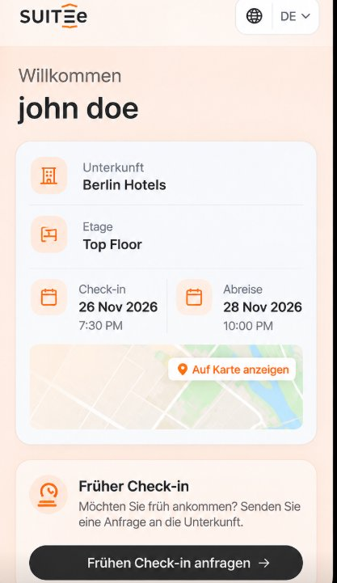
</Frame>

Die obere Übersichtskarte zeigt:

| Feld | Beschreibung |
| :--- | :--- |
| **Unterkunft** | Der Name der Unterkunft für Ihre Reservierung (z. B. `Berlin Hotels`). |
| **Zimmer** | Details zu Ihrem zugewiesenen Zimmer oder Ihrer Einheit (zeigt die in Ihrem Aufenthalt enthaltenen Zimmer). |
| **Etage** | Die Etage, auf der sich Ihr Zimmer befindet (z. B. `Top Floor`). |
| **Check-in / Abreise** | Ihre geplanten Check-in- und Check-out-Daten sowie Uhrzeiten. |
| **Auf Karte anzeigen** | Eine Kartenvorschau, die Sie zur Orientierung für den Standort der Unterkunft öffnen können. |

Unterhalb der Übersichts- und Infokarten zeigt die Seite zudem Ihre zugewiesenen **Zimmer** sowie die **verbundenen Geräte** (wie smarte Türschlösser, Thermostate und Schalter), sodass Sie während Ihres gesamten Aufenthalts volle Übersicht und Kontrolle haben.

---

## Frühen Check-in anfragen

<Note>
  Die Option **Früher Check-in** ist nur vor Ihrer regulären Check-in-Zeit sichtbar. Liegt Ihre geplante Check-in-Zeit beispielsweise bei **19:00 Uhr (7:00 PM)** und Sie möchten um **18:30 Uhr (6:30 PM)** anreisen, wird die Option für den frühen Check-in angezeigt. Sobald Ihre geplante Check-in-Zeit verstrichen ist (zum Beispiel um **19:10 Uhr** oder **19:15 Uhr**), wird die Option für den frühen Check-in nicht mehr angezeigt.
</Note>

Wenn Sie vor Ihrer geplanten Check-in-Zeit anreisen möchten, klicken Sie im Banner **Früher Check-in** auf **Frühen Check-in anfragen →**.

<Frame>
  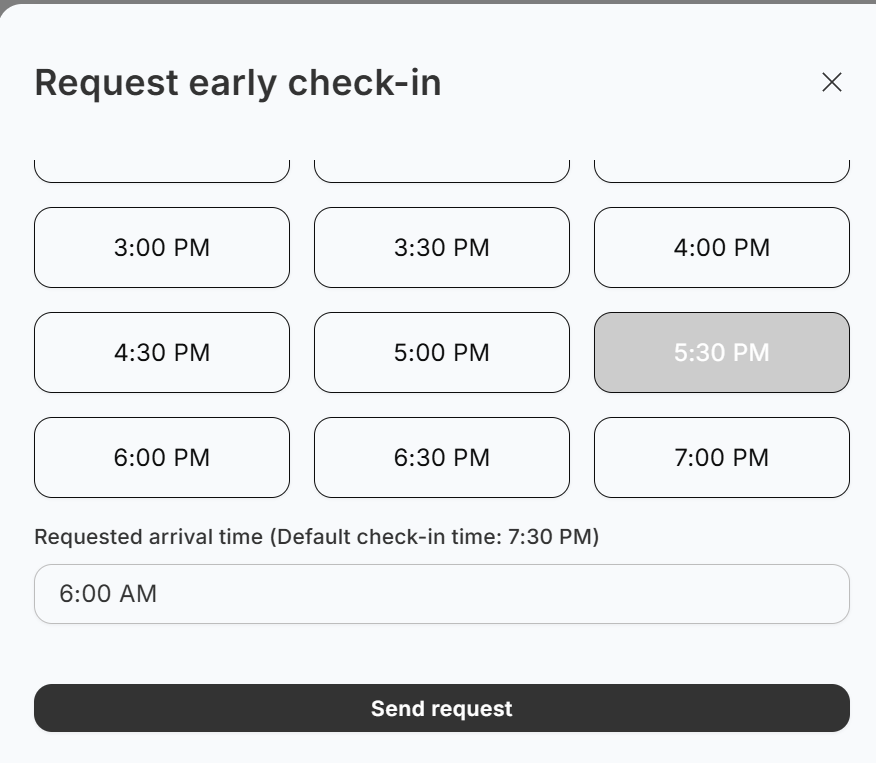
</Frame>

<Steps>
  <Step title="Ankunftszeit auswählen">
    Wählen Sie eines der verfügbaren Zeitfenster (z. B. `3:00 PM` bis `7:00 PM`) aus oder legen Sie Ihre gewünschte Uhrzeit unter **Requested arrival time** fest.
  </Step>

  <Step title="Anfrage absenden">
    Klicken Sie auf **Send request**, um Ihre gewünschte frühere Ankunftszeit zu übermitteln. Auf der Seite erscheint daraufhin der Hinweis **Early check-in requested** (*We'll let you know when the property responds.*) mit der angefragten Uhrzeit und einer Aktualisierungs-Schaltfläche.

    <Frame>
      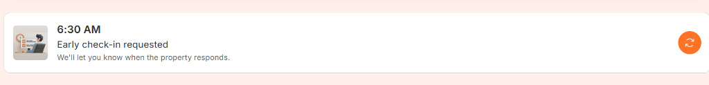
    </Frame>
  </Step>

  <Step title="Auf Genehmigung und Bestätigung warten">
    Sobald der Unterkunfts-Administrator oder SUITEe Ihre Anfrage annimmt, aktualisiert sich die Gäste-Web-App und bestätigt Ihre neue Ankunftszeit (**Your arrival time is confirmed for 6:30 AM.** — *Room is getting ready for check-in*).

    <Frame>
      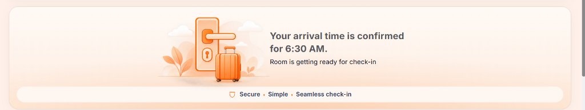
    </Frame>
  </Step>
</Steps>

---

## Regulärer Check-in (pünktlich)

Sobald Ihre geplante Check-in-Zeit erreicht ist (regulärer Check-in), zeigt die Gäste-Web-App das Banner **Ihr Zimmer ist bereit** (*Check-in ist jetzt verfügbar*) mit der Schaltfläche **Check-in →** an.

<Frame>
  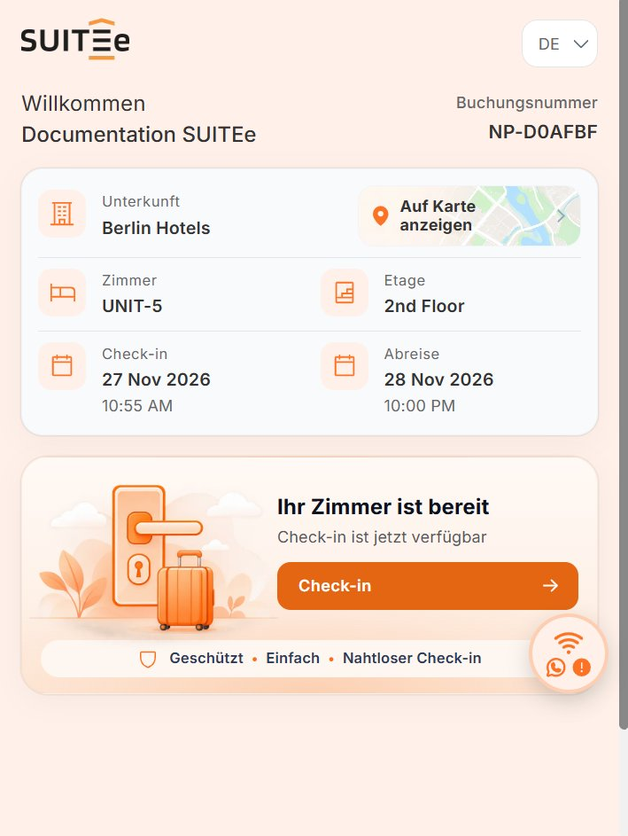
</Frame>

<Steps>
  <Step title="Auf Check-in klicken">
    Klicken Sie auf **Check-in →**, um Ihren Check-in abzuschließen.
  </Step>

  <Step title="Check-in-Bestätigung anzeigen">
    Es erscheint sofort eine Bestätigungsmeldung mit **Sie sind eingecheckt!** (*Ihr Zimmer ist bereit.*).

    <Frame>
      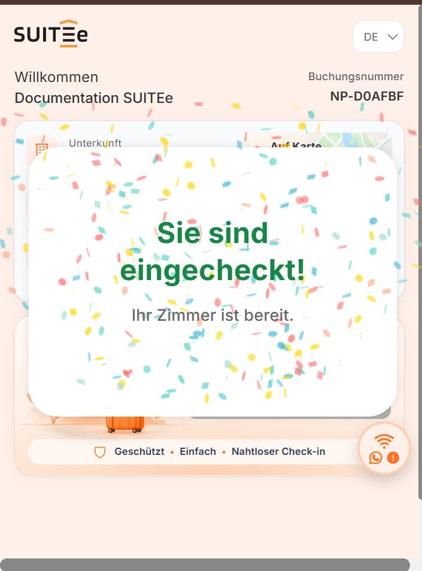
    </Frame>
  </Step>
</Steps>

### Nach dem Check-in

Nach dem Check-in aktualisiert sich die Gäste-Web-App und stellt Ihnen alle Aufenthaltsfunktionen, Ihren Tür-PIN und die Navigationsleiste zur Verfügung:

<Frame>
  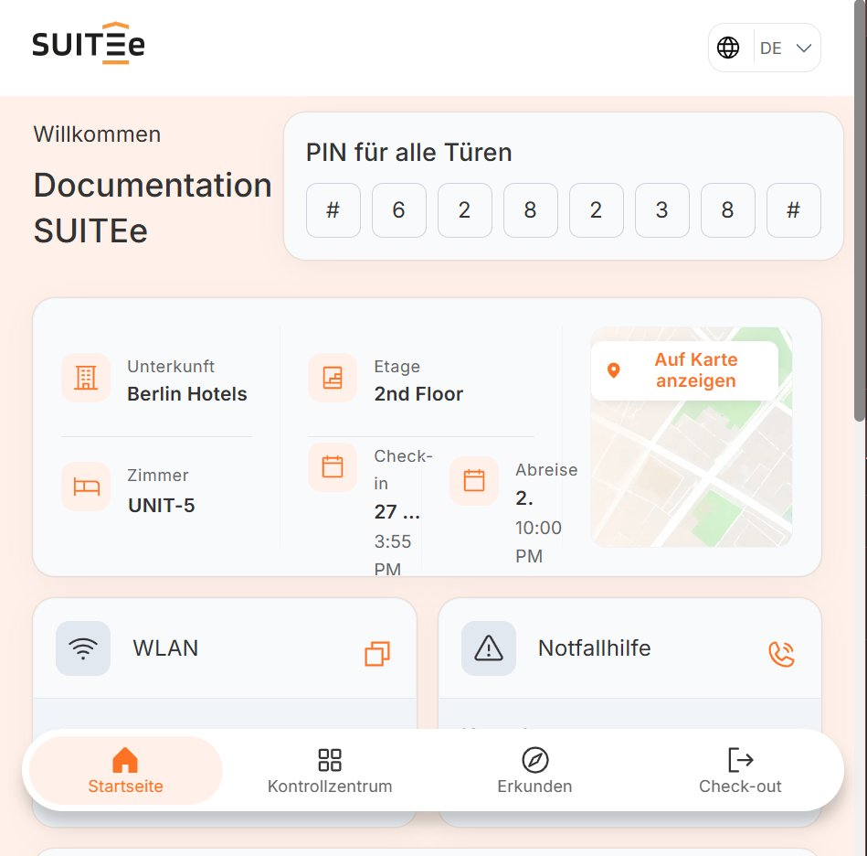
</Frame>

- **PIN für alle Türen**: Ihr numerischer PIN-Code (zum Beispiel `# 6 2 8 2 3 8 #`) wird oben rechts im Begrüßungsbereich für die Eingabe am Türtastenfeld angezeigt.
- **Navigationsleiste**: Über die untere Leiste wechseln Sie zwischen **Startseite**, **Kontrollzentrum**, **Erkunden** und **Check-out**.
- **Vorschau des Kontrollzentrums**: Wenn Sie auf der Startseite nach unten scrollen, können Sie verbundene Türschlösser (wie **Zimmertürschloss** und **Main door lock public unit 4**) direkt über **Entriegeln** öffnen oder in der unteren Navigationsleiste auf **Kontrollzentrum** tippen, um sämtliche verbundenen Geräte zu steuern.

<Frame>
  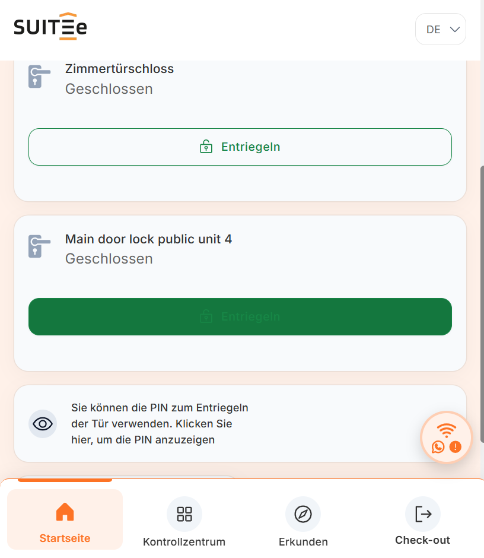
</Frame>

---

## Nutzung des Kontrollzentrums

Das **Kontrollzentrum** (**Control Center**) ist Ihre zentrale Steuerungsansicht für alle smarten Geräte Ihres Aufenthalts — Türen, Raumklima und Unterhaltung — auf einem einzigen Bildschirm.

In der **Control Center**-Vorschau auf Ihrer Startseite können Sie:
- Bei **Zimmertürschloss** auf **Entriegeln** klicken, um Ihre Zimmertür zu öffnen.
- Bei **Main door lock public unit 4** auf **Entriegeln** klicken, um die Haupteingangstür des Gebäudes zu öffnen.
- Auf der Karte **Kontrollzentrum** auf **Alle anzeigen** klicken — oder in der unteren Navigationsleiste auf **Kontrollzentrum** tippen —, um alle Ihrem Zimmer zugewiesenen Geräte anzuzeigen und zu bedienen.

### 1. Zugang (`Zugang`)

Ganz oben im vollständigen Kontrollzentrum (**Verwalten Sie alle Ihre Zimmergeräte**) zeigt der Bereich **Zugang** Ihren **PIN für alle Türen** sowie Schnell-Entriegelungsfunktionen für alle Ihrer Buchung zugewiesenen Türen.

<Frame>
  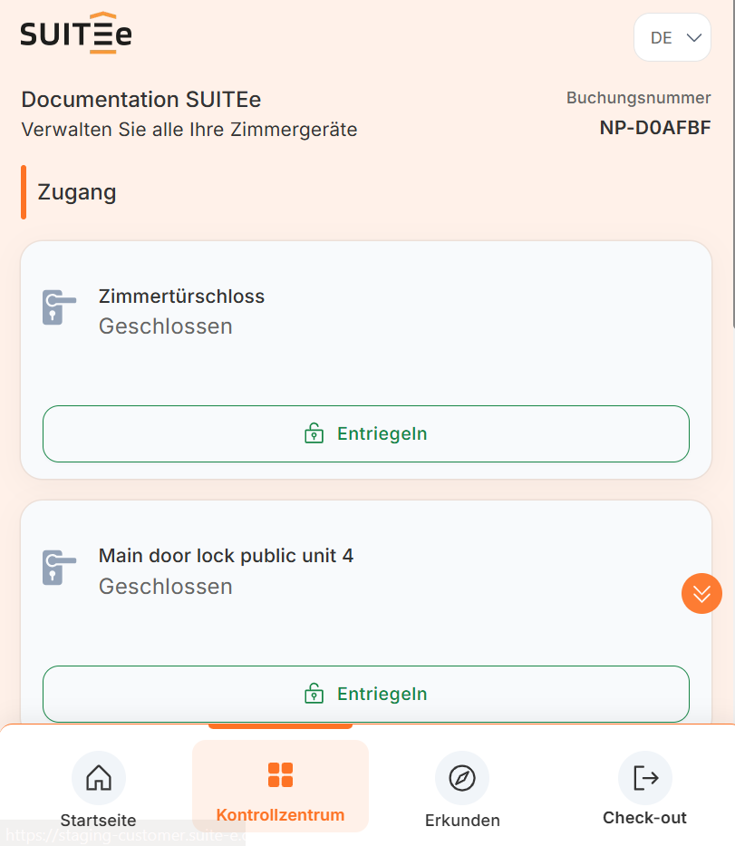
</Frame>

- Klicken Sie bei **Zimmertürschloss** auf **Entriegeln**, um Ihre Zimmertür zu öffnen, oder auf die Karte der Haupteingangstür, um den Gebäudeeingang zu entriegeln.
- Verwenden Sie den oben rechts angezeigten Code unter **PIN für alle Türen**, wenn Sie die Tür lieber über das Tastenfeld am Schloss öffnen möchten.

### 2. Klimasteuerung (`Klimasteuerung`)

Über das Bedienfeld **Klimasteuerung** steuern Sie Heizung, Kühlung und Luftzirkulation in Ihrem Zimmer direkt über Ihr Smartphone oder Ihren Computer.

<Frame>
  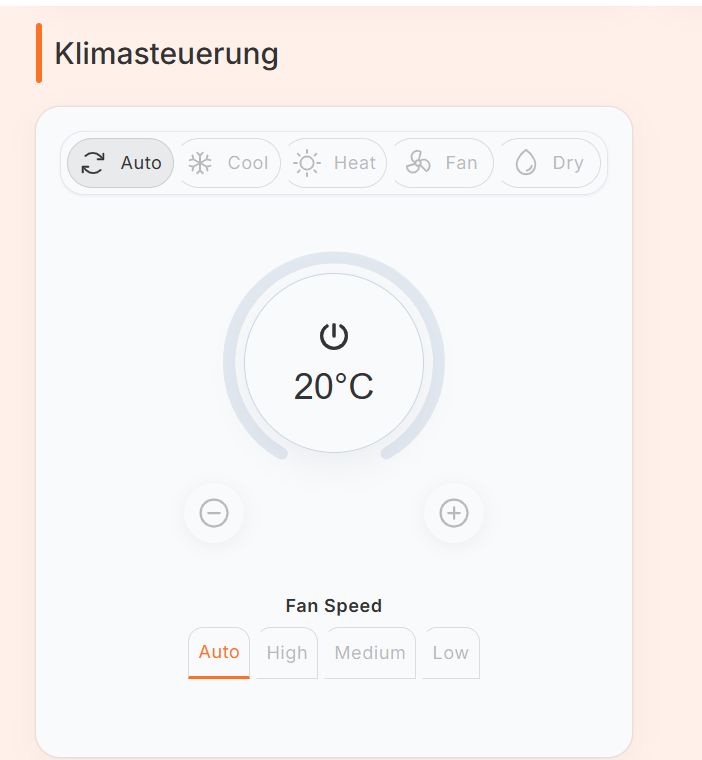
</Frame>

So bedienen Sie die **Klimasteuerung**:

| Bedienelement | Bedienung |
| :--- | :--- |
| **Modusleiste (`Auto`, `Cool`, `Heat`, `Fan`, `Dry`)** | Tippen Sie auf einen Modus, um zwischen automatischer Temperaturregelung, Kühlung, Heizung, reinem Lüfterbetrieb oder Entfeuchtung (`Dry`) zu wechseln. |
| **Ein-/Ausschalter (`⏻`)** | Tippen Sie auf das Einschaltsymbol in der Mitte des Reglers, um die Klimatisierung ein- oder auszuschalten. |
| **Temperatur (`−` / `+`)** | Tippen Sie unterhalb des Reglers auf **−** oder **+**, um die gewünschte Raumtemperatur (in der Mitte angezeigt, z. B. `20°C`) zu senken oder zu erhöhen. |
| **Lüftergeschwindigkeit (`Fan Speed`: `Auto`, `High`, `Medium`, `Low`)** | Wählen Sie unten die gewünschte Lüfterstufe aus oder belassen Sie die Einstellung auf **Auto** für eine automatische Anpassung. |

### 3. Unterhaltung (`Unterhaltung`)

Das Bedienfeld **Unterhaltung** verwandelt die Gäste-Web-App in eine **TV-Fernbedienung** (virtuelle Fernbedienung), sodass Sie den Fernseher im Zimmer bequem ohne physische Fernbedienung steuern können.

<Frame>
  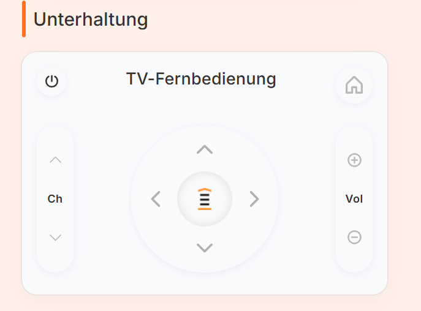
</Frame>

So bedienen Sie die **TV-Fernbedienung**:

| Bedienelement | Bedienung |
| :--- | :--- |
| **Ein-/Ausschalter (`⏻`, oben links)** | Schaltet den Fernseher ein oder aus. |
| **Startseite (`⌂`, oben rechts)** | Kehrt zum Startbildschirm oder Smart-TV-Menü des Fernsehers zurück. |
| **Kanäle (`Ch` `^` / `v`, links)** | Schaltet die Fernsehkanäle nach oben oder unten. |
| **Steuerkreuz & mittlere Taste** | Navigieren Sie mit den Pfeiltasten (**oben**, **unten**, **links**, **rechts**) durch die Menüs und drücken Sie die mittlere Taste zur Auswahl oder Bestätigung. |
| **Lautstärke (`Vol` `+` / `−`, rechts)** | Erhöht oder verringert die Lautstärke des Fernsehers. |

---

## Erkunden (`Erkunden`)

Tippen Sie in der unteren Navigationsleiste auf **Erkunden**, um **Orte in der Nähe** Ihrer Unterkunft zu entdecken. Dieser Bereich hilft Gästen dabei, lokale Sehenswürdigkeiten, Einkaufsmöglichkeiten, Restaurants und Ausflugsziele kennenzulernen und deren genauen Standort während des Aufenthalts mühelos zu finden.

<Frame>
  
</Frame>

<Frame>
  
</Frame>

<Frame>
  
</Frame>

- **Orte in der Nähe entdecken**: Durchsuchen Sie ausgewählte Sehenswürdigkeiten, Attraktionen und lokale Empfehlungen Ihrer Unterkunft.
- **Standorte einfach finden**: Sehen Sie Ortsdetails und Standortinformationen auf einen Blick, sodass Sie jedes Ziel direkt und ohne langes Suchen erreichen.

<Info>
  Unterkunfts-Manager können die hier angezeigten Orte in der Nähe auf der Seite [Explore](/de/dashboard/explore) hinzufügen und verwalten.
</Info>
