Die **Gäste-Web-App** ist ein browserbasiertes Portal für Ihre Gäste. Ihre Gäste können es direkt auf ihrem Smartphone oder Computer öffnen, ohne eine App herunterladen zu müssen.

Sie können die Gäste-Web-App direkt über das [Dashboard](/de/dashboard/overview) auf [hotel.suite-e.com](https://hotel.suite-e.com/) öffnen und teilen.

---

## Zugriff auf die Gäste-Web-App über das Dashboard

Wenn Sie das [Dashboard](/de/dashboard/overview) unter [hotel.suite-e.com](https://hotel.suite-e.com/) öffnen, sehen Sie im Begrüßungsbanner die orangefarbene Schaltfläche **Web App**.

<Frame>
  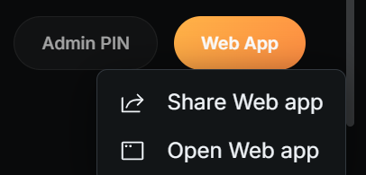
</Frame>

Klicken Sie auf **Web App**, um ein Dropdown-Menü mit zwei Optionen zu öffnen:

| Option | Beschreibung |
| :--- | :--- |
| **Share Web app** | Kopieren oder teilen Sie den Link zur Gäste-Web-App, damit Gäste oder Mitarbeiter sie direkt öffnen können. |
| **Open Web app** | Öffnen Sie die Gäste-Web-App in einem neuen Browser-Tab, um das Gäste-Erlebnis anzuzeigen oder zu testen. |

<Info>
  Weitere Informationen zu den Steuerelementen des Dashboards finden Sie in der Anleitung zum [Dashboard](/de/dashboard/overview).
</Info>

---

## Öffnen der Gäste-Web-App

Wenn Sie auf **Open Web app** klicken, öffnet sich die Gäste-Web-App auf dem Bildschirm zur Buchungsbestätigung (**Buchung bestätigen**).

<Frame>
  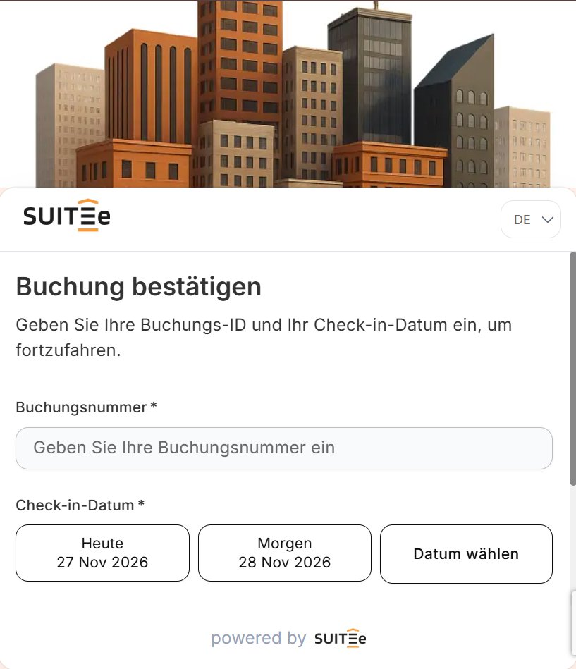
</Frame>

Auf diesem Bildschirm bestätigt ein Gast seine Reservierung, bevor er zu seiner Aufenthaltsansicht gelangt:

<Steps>
  <Step title="Sprache auswählen">
    Verwenden Sie die Sprachauswahl oben rechts (zum Beispiel **DE**), um die Sprache der Benutzeroberfläche zu wechseln.
  </Step>
  <Step title="Buchungsnummer eingeben">
    Geben Sie die Reservierungs-ID in das Feld **Buchungsnummer \*** ein.
  </Step>
  <Step title="Check-in-Datum auswählen">
    Wählen Sie das **Check-in-Datum \*** über die Schnellauswahl aus oder klicken Sie auf **Datum wählen**, um ein Datum festzulegen.
  </Step>
  <Step title="Bedingungen akzeptieren und bestätigen">
    Aktivieren Sie das Kontrollkästchen, um den Allgemeinen Geschäftsbedingungen und der Datenschutzrichtlinie zuzustimmen, und klicken Sie anschließend auf **Buchung bestätigen**, um fortzufahren.
  </Step>
</Steps>

<Note>
  **Wichtig:** Das Registrierungsformular öffnet sich nicht automatisch für jeden Gast. Ohne den Abschluss dieser Registrierung werden die Gästedaten nicht gespeichert. Wenn die Registrierungsseite nicht angezeigt wird, wenden Sie sich an den [SUITEe-Support](https://suite-e.com/contact-us/), um den Zugriff auf das Registrierungsformular freischalten zu lassen.
</Note>

Sobald der Zugriff auf das Registrierungsformular aktiviert ist, folgen Sie den nachstehenden Schritten, um Ihre Buchung zu bestätigen, Ihren Passcode zu erstellen, die Registrierung abzuschließen und sich anzumelden.

---

## Buchungs-ID und Check-in-Datum bestätigen

Um eine Reservierung in der Gäste-Web-App zu bestätigen, benötigt der Gast seine **Buchungs-ID** (entweder die **PMS-Buchungs-ID** oder die **Externe Buchungs-ID**) sowie das **Check-in-Datum**. Teilen Sie diese Angaben dem Gast mit oder sehen Sie sie auf der Seite [Buchungen](/de/dashboard/booking) nach.

<Note>
  **Was ist der Unterschied zwischen PMS-Buchungs-ID und Externer Buchungs-ID?**
  - **PMS-Buchungs-ID (`Buchungs-ID`)**: Die primäre Reservierungskennung aus Ihrem Property Management System — oder die von SUITEe für Unterkünfte ohne PMS generierte ID (zum Beispiel `NP-9B4ADC-1`).
  - **Externe Buchungs-ID (`Externe Buchungs-ID`)**: Die Buchungsreferenz eines externen Buchungskanals oder OTAs (z. B. Booking.com oder Expedia), die in der Spalte **Externe Buchungs-ID** auf der Seite [Buchungen](/de/dashboard/booking) angezeigt wird (bei Direktbuchungen steht dort `—`).

  Geben Sie je nach Buchungsart die dem Gast mitgeteilte **PMS-Buchungs-ID** oder **Externe Buchungs-ID** ein (zum Beispiel `NP-9B4ADC-1`).
</Note>

So bestätigen Sie die Buchung in der Gäste-Web-App:

<Steps>
  <Step title="Buchungs-ID eingeben">
    Geben Sie Ihre **PMS-Buchungs-ID** oder **Externe Buchungs-ID** (zum Beispiel `NP-9B4ADC-1`) in das Feld **Buchungsnummer \*** ein.
  </Step>

  <Step title="Check-in-Datum auswählen">
    Wählen Sie das passende **Check-in-Datum** unter **Check-in-Datum \*** über **Heute**, **Morgen** oder **Datum wählen** aus.
  </Step>

  <Step title="Bedingungen akzeptieren und bestätigen">
    Aktivieren Sie das Kontrollkästchen, um den Allgemeinen Geschäftsbedingungen und der Datenschutzrichtlinie zuzustimmen, und klicken Sie auf **Buchung bestätigen**, um die Buchung zu prüfen und fortzufahren.
  </Step>
</Steps>

---

## Ihren 4-stelligen Passcode erstellen

Nachdem Sie auf **Buchung bestätigen** geklickt haben, öffnet sich der Bildschirm **Erstellen Sie Ihren 4-stelligen Login-Code**, auf dem Sie Ihren persönlichen Passcode und eine Wiederherstellungs-E-Mail-Adresse festlegen.

<Frame>
  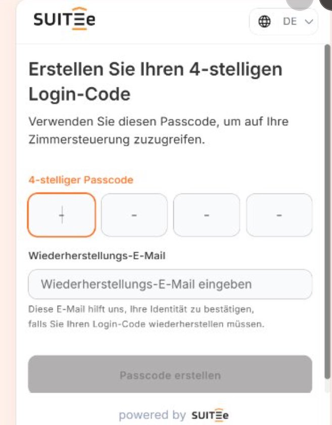
</Frame>

<Steps>
  <Step title="4-stelligen Passcode eingeben">
    Geben Sie einen 4-stelligen Code in die Felder für den **4-stelligen Passcode** ein. Mit diesem Passcode greifen Sie später auf Ihre Zimmersteuerung und Ihre Aufenthaltsdetails zu.
  </Step>

  <Step title="Wiederherstellungs-E-Mail hinzufügen">
    Geben Sie Ihre E-Mail-Adresse unter **Wiederherstellungs-E-Mail** ein. SUITEe nutzt diese E-Mail-Adresse zur Bestätigung Ihrer Identität, falls Sie Ihren Login-Code zurücksetzen müssen.
  </Step>

  <Step title="Passcode erstellen">
    Klicken Sie auf **Passcode erstellen**, um Ihren Passcode zu speichern und fortzufahren.
  </Step>
</Steps>

---

## Ausfüllen des Gästeregistrierungsformulars

<Note>
  **Wichtig:** Wenn Ihre Unterkunft die Gästeregistrierung von SUITEe nutzt, ist das Ausfüllen dieses Registrierungsformulars **verpflichtend**. Ist die Gästeregistrierung für Ihre Unterkunft nicht aktiviert, wird dieses Formular nicht angezeigt — stattdessen melden Sie sich direkt mit Ihrer **Buchungs-ID** und Ihrem **4-stelligen Passcode** an, und das Registrierungsformular ist nicht erforderlich.
</Note>

Wenn die Gästeregistrierung aktiviert ist, füllen Sie das zweiteilige Registrierungsformular nach dem Erstellen Ihres Passcodes sorgfältig aus.

### Schritt 1: Persönliche Daten (`Legen wir los`)

Überprüfen Sie auf dem Bildschirm **Legen wir los** zunächst die vorausgefüllten Felder **Anreisedatum \*** und **Abreisedatum \*** und geben Sie anschließend Ihre persönlichen Daten ein.

<Frame>
  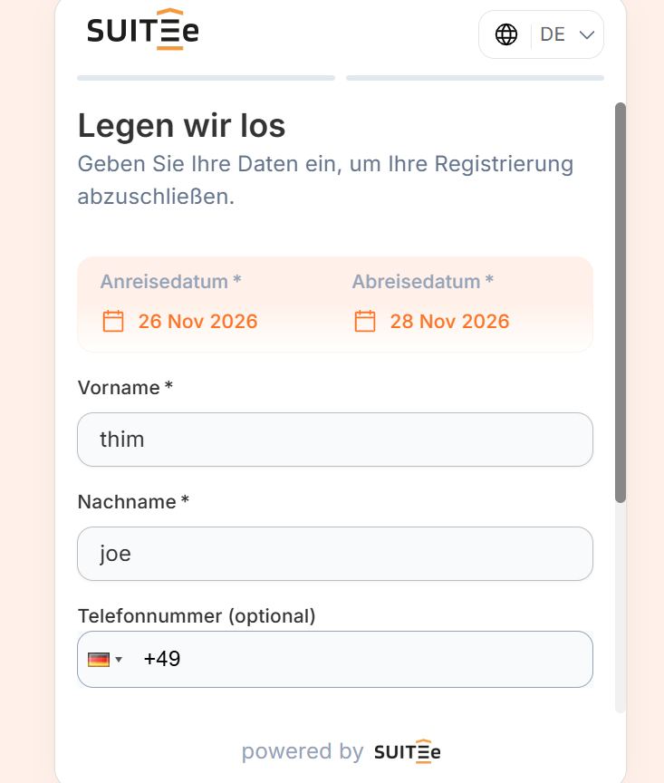
</Frame>

<Frame>
  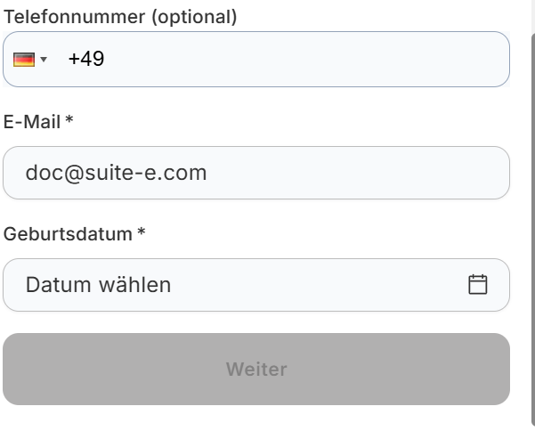
</Frame>

Füllen Sie die folgenden Felder aus und klicken Sie auf **Weiter**, um zum nächsten Schritt zu gelangen:

- **Vorname \*** — Vorname (Pflichtfeld)
- **Nachname \*** — Nachname (Pflichtfeld)
- **Telefonnummer (optional)** — Telefonnummer mit Ländervorwahl
- **E-Mail \*** — E-Mail-Adresse (Pflichtfeld)
- **Geburtsdatum \*** — Geburtsdatum über **Datum wählen** (Pflichtfeld)

<Warning>
  **Pflichtfeldprüfung:** Alle mit `*` gekennzeichneten Pflichtfelder müssen korrekt ausgefüllt werden, bevor die Schaltfläche **Weiter** aktiviert wird. Sowohl **Vorname \*** als auch **Nachname \*** müssen mindestens **3 Zeichen** lang sein — kürzere Eingaben lösen Fehlermeldungen aus (*Name muss mindestens 3 Zeichen lang sein* und *Nachname muss mindestens 3 Zeichen lang sein*).

  <Frame>
    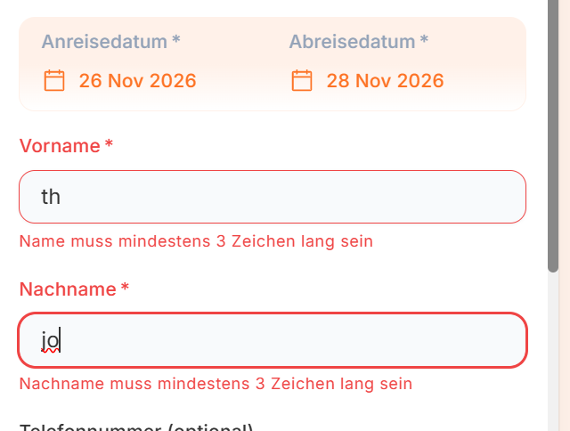
  </Frame>
</Warning>

### Schritt 2: Ausweisdaten, Adresse, Unterschrift und weitere Gäste

Nach dem Klick auf **Weiter** öffnet sich der Bildschirm **Nur noch ein paar Details!**. Geben Sie alle erforderlichen Ausweis- und Adressdaten ein, fügen Sie Ihre Unterschrift hinzu und tragen Sie gegebenenfalls mitreisende Gäste ein.

<Frame>
  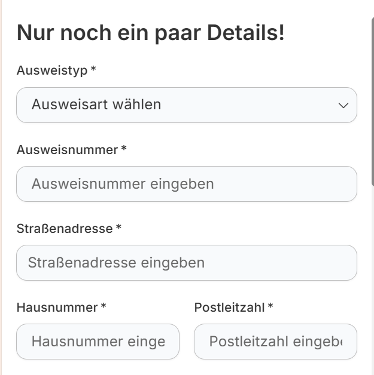
</Frame>

<Frame>
  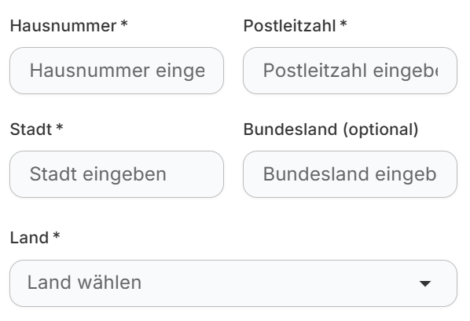
</Frame>

<Frame>
  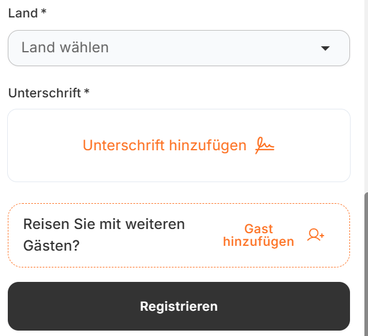
</Frame>

1. Wählen Sie Ihren **Ausweistyp \*** über **Ausweisart wählen** aus und geben Sie Ihre **Ausweisnummer \*** ein.
2. Tragen Sie **Straßenadresse \***, **Hausnummer \***, **Postleitzahl \***, **Stadt \*** sowie optional **Bundesland** ein und wählen Sie unter **Land \*** über **Land wählen** Ihr Land aus.
3. Klicken Sie unter **Unterschrift \*** auf **Unterschrift hinzufügen** und leisten Sie eine deutliche Unterschrift.
4. *(Optional)* Wenn Sie mit weiteren Gästen reisen, klicken Sie unter **Reisen Sie mit weiteren Gästen?** auf **Gast hinzufügen**, um **Gast 1 Info** zu öffnen, und geben Sie für jeden Gast **Vorname \***, **Nachname \***, **Geburtsdatum \*** (**Datum wählen**) und **Nationalität \*** (**Land wählen**) ein.

   <Frame>
     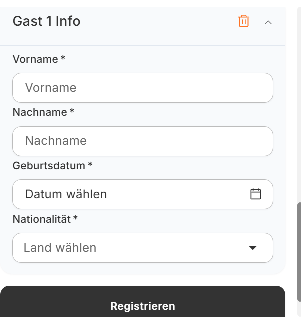
   </Frame>

5. Klicken Sie auf **Registrieren**, um Ihre Registrierung abzuschließen.

---

## Anmeldung mit Ihrem 4-stelligen Passcode

Nach dem Klick auf **Registrieren** zeigt die Gäste-Web-App den Anmeldebildschirm (**Melden Sie sich in Ihrer SUITEe an**) an. Geben Sie den zuvor erstellten **4-stelligen Passcode** ein, um sich anzumelden.

<Frame>
  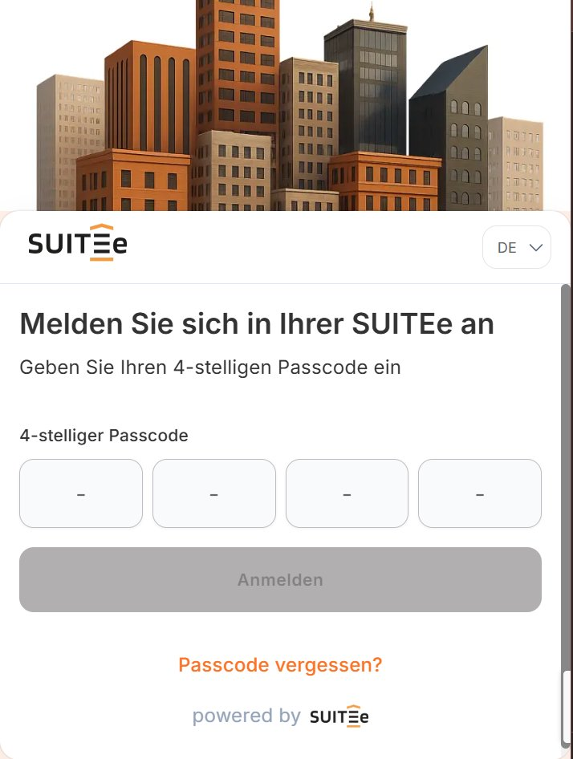
</Frame>

<Steps>
  <Step title="4-stelligen Passcode eingeben">
    Geben Sie auf dem Bildschirm **Melden Sie sich in Ihrer SUITEe an** Ihren zuvor festgelegten 4-stelligen Passcode in die Felder für den **4-stelligen Passcode** ein.
  </Step>

  <Step title="Auf Anmelden klicken">
    Klicken Sie auf **Anmelden**, um Ihre Aufenthaltsübersicht in der Gäste-Web-App zu öffnen.

    <Tip>
      Falls Sie Ihren Passcode einmal vergessen sollten, klicken Sie unterhalb der Schaltfläche **Anmelden** auf **Passcode vergessen?**, um ihn über Ihre Wiederherstellungs-E-Mail zurückzusetzen.
    </Tip>
  </Step>
</Steps>

---

## Nächste Schritte

<Card title="Gäste-Web-App" icon="mobile-screen" href="/de/guest-web-app/guest-web-app">
  Entdecken Sie Ihre Aufenthaltsdetails nach der Anmeldung — Willkommensseite, Anfragen für frühen Check-in, Check-in, Tür-PIN und Kontrollzentrum.
</Card>
