Once you complete booking verification and sign in with your 4-digit passcode (see [Guest Web App Overview](/en/guest-web-app/overview)), the **Guest Web App** opens on your stay dashboard.

---

## Welcome page and stay details

After logging in, the Guest Web App opens on your **welcome page** (**Willkommen**), where you can view your reservation details, assigned rooms, connected devices, and property information in one place.

<Frame>
  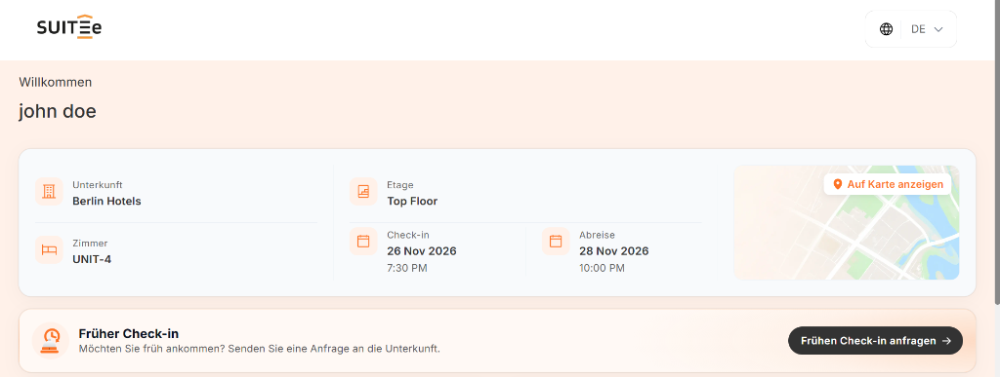
</Frame>

The top summary card displays:

| Field | Description |
| :--- | :--- |
| **Unterkunft** | The property name for your reservation (e.g., `Berlin Hotels`). |
| **Zimmer** | Your assigned room or unit details (showing the room(s) included in your stay). |
| **Etage** | The floor where your room is located (e.g., `Top Floor`). |
| **Check-in / Abreise** | Your scheduled check-in and check-out dates and times. |
| **Auf Karte anzeigen** | A map preview you can open for property location reference. |

Below the summary and utility cards, the page also shows your assigned **rooms** and **connected devices** (such as smart locks, thermostats, and switches) so you have full visibility and control during your stay.

---

## Requesting early check-in

<Note>
  The **Early check-in** (**Früher Check-in**) option is only visible before your scheduled check-in time. For example, if your scheduled check-in time is **7:00 PM** and you arrive at **6:30 PM**, the early check-in option is visible. Once your scheduled check-in time has passed (for example, at **7:10 PM** or **7:15 PM**), the early check-in option is no longer shown.
</Note>

If you plan to arrive before your scheduled check-in time, click **Frühen Check-in anfragen →** on the **Früher Check-in** banner.

<Frame>
  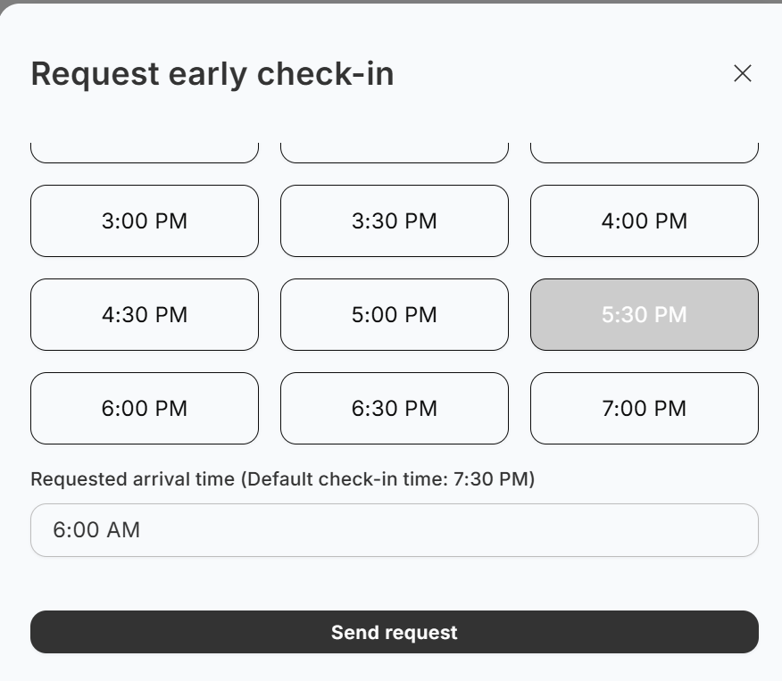
</Frame>

<Steps>
  <Step title="Choose your arrival time">
    Select one of the available time slot buttons (such as `3:00 PM` through `7:00 PM`) or set your preferred time in **Requested arrival time**.
  </Step>

  <Step title="Send the request">
    Click **Send request** to submit your early check-in timing. The page updates to display **Early check-in requested** (*We'll let you know when the property responds.*) with your requested time and a refresh button.

    <Frame>
      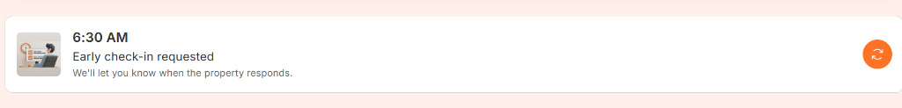
    </Frame>
  </Step>

  <Step title="Wait for approval and confirmation">
    Once the property administrator or SUITEe accepts your request, the Guest Web App updates to confirm your new arrival time (**Your arrival time is confirmed for 6:30 AM.** — *Room is getting ready for check-in*).

    <Frame>
      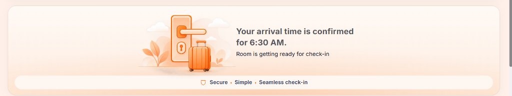
    </Frame>
  </Step>
</Steps>

---

## Checking in on time

When your scheduled check-in time arrives (on-time check-in), the Guest Web App displays the **Your room is ready** (*Check-in is available now*) banner with the **Check in →** button.

<Frame>
  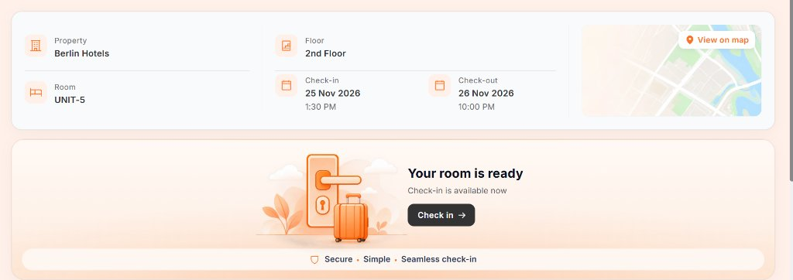
</Frame>

<Steps>
  <Step title="Click Check in">
    Click **Check in →** to complete your check-in.
  </Step>

  <Step title="View your check-in confirmation">
    A confirmation screen immediately appears displaying **You're checked in!** (*Your room is ready.*).

    <Frame>
      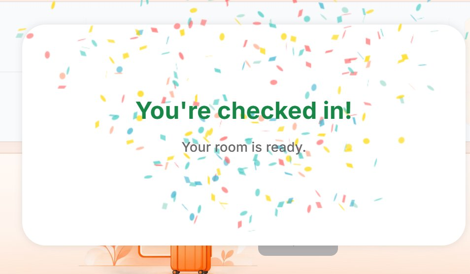
    </Frame>
  </Step>
</Steps>

### After you check in

Once checked in, the Guest Web App updates with your full stay controls, door PIN, and navigation bar:

<Frame>
  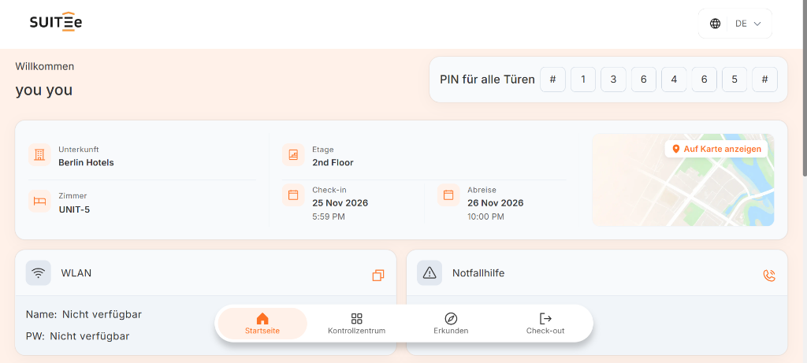
</Frame>

- **PIN für alle Türen (All Door PIN)**: Your numeric PIN code (for example, `# 1 3 6 4 6 5 #`) appears in the top-right corner of the welcome header for keypad entry.
- **Navigation bar**: A bottom bar lets you switch between **Startseite** (Home), **Kontrollzentrum** (Control center), **Erkunden** (Explore), and **Check-out**.
- **Control Center preview**: Below **Mit Unterkunft chatten**, you can unlock connected locks directly (such as **Zimmertürschloss** and **Main door lock public unit 4**) using **Entriegeln** (Unlock), or click **Alle anzeigen** under **Kontrollzentrum** (*Alle Geräte, eine Steuerung*) to manage every connected device.

<Frame>
  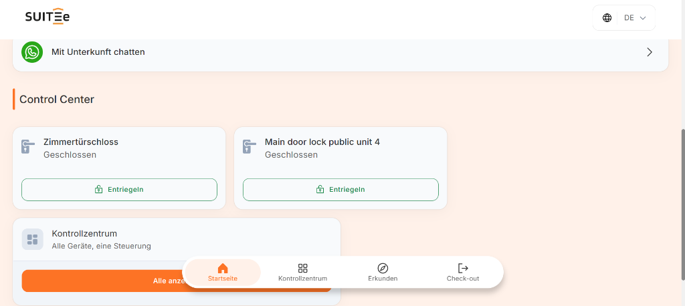
</Frame>

---

## Using the Control Center

The **Control Center** (**Kontrollzentrum**) is your central hub for managing every smart device connected to your stay—doors, room climate, and entertainment—from one screen.

From the **Control Center** preview on your Home page:
- Click **Entriegeln** (Unlock) on **Zimmertürschloss** to open your room door.
- Click **Entriegeln** (Unlock) on **Main door lock public unit 4** to open the main building door.
- Click **Alle anzeigen** (View All) on the **Kontrollzentrum** card—or tap **Kontrollzentrum** in the bottom navigation bar—to view and control all devices assigned to your room.

### 1. Access (`Zugang`)

At the top of the full Control Center (**Verwalten Sie alle Ihre Zimmergeräte**), the **Zugang** (Access) section displays your **PIN für alle Türen** alongside quick-unlock controls for every door assigned to your booking.

<Frame>
  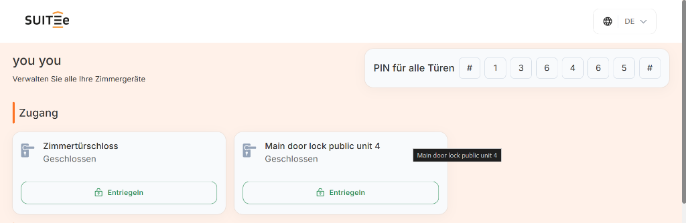
</Frame>

- Click **Entriegeln** on **Zimmertürschloss** to unlock your room door, or on the main door lock card to unlock the building entrance.
- Use the **PIN für alle Türen** code shown at the top right if you prefer to enter via the door keypad.

### 2. Climate control (`Klimasteuerung`)

The **Klimasteuerung** (Climate control) panel lets you manage the heating, cooling, and airflow in your room directly from your phone or computer.

<Frame>
  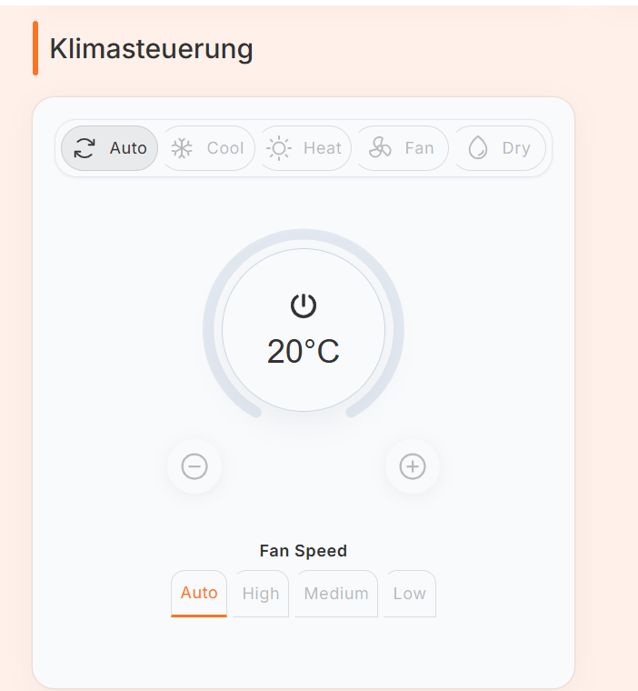
</Frame>

How to use **Klimasteuerung**:

| Control | How to use it |
| :--- | :--- |
| **Mode bar (`Auto`, `Cool`, `Heat`, `Fan`, `Dry`)** | Tap a mode to switch between automatic temperature regulation, cooling, heating, fan-only circulation, or dehumidifying (`Dry`). |
| **Power button (`⏻`)** | Tap the power icon inside the circular dial to turn the climate system on or off. |
| **Temperature (`−` / `+`)** | Tap **−** or **+** below the dial to lower or raise the target room temperature (shown in the center, e.g., `20°C`). |
| **Fan Speed (`Auto`, `High`, `Medium`, `Low`)** | Choose your preferred fan speed at the bottom, or leave it on **Auto** for automatic adjustment. |

### 3. Entertainment (`Unterhaltung`)

The **Unterhaltung** (Entertainment) panel turns the Guest Web App into a **TV-Fernbedienung** (virtual TV remote control) so you can operate your in-room TV without needing a physical remote.

<Frame>
  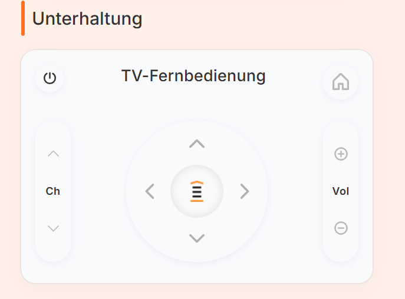
</Frame>

How to use **TV-Fernbedienung**:

| Control | How to use it |
| :--- | :--- |
| **Power (`⏻`, top-left)** | Turn the TV on or off. |
| **Home (`⌂`, top-right)** | Return to the TV's home screen or smart app menu. |
| **Ch (`^` / `v`, left)** | Switch TV channels up or down. |
| **Directional pad & center button** | Use the **up**, **down**, **left**, and **right** arrows to navigate TV menus, and press the center button to select or confirm. |
| **Vol (`+` / `−`, right)** | Increase or decrease the TV volume. |

---

## Explore (`Erkunden`)

Tap **Erkunden** (Explore) in the bottom navigation bar to browse **nearby places** around your property. This section helps guests discover local attractions, shopping destinations, dining spots, and landmarks—and find their exact locations easily during their stay.

<Frame>
  
</Frame>

<Frame>
  
</Frame>

<Frame>
  
</Frame>

- **Discover nearby places**: Browse curated points of interest, attractions, and local businesses recommended by your property.
- **Find locations easily**: Quickly view place details and location references so you can reach each destination without searching elsewhere.

<Info>
  Property managers can add and manage the nearby places shown here from the [Explore](/en/dashboard/explore) page.
</Info>
