The **Guest Web App** is a browser-based portal for your guests. They can open it directly on their smartphone or computer without downloading an app.

You can access and share the Guest Web App directly from the [Dashboard](/en/dashboard/overview) on [hotel.suite-e.com](https://hotel.suite-e.com/).

---

## Accessing the Guest Web App from the Dashboard

When you go to the [Dashboard](/en/dashboard/overview) at [hotel.suite-e.com](https://hotel.suite-e.com/), the welcome banner displays the orange **Web App** button.

<Frame>
  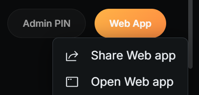
</Frame>

Click **Web App** to open a dropdown menu with two options:

| Option | Description |
| :--- | :--- |
| **Share Web app** | Copy or share the Guest Web App link so guests or staff can open it directly. |
| **Open Web app** | Launch the Guest Web App in a new browser tab to preview or use the guest experience. |

<Info>
  For more details on dashboard controls, see the [Dashboard](/en/dashboard/overview) guide.
</Info>

---

## Opening the Guest Web App

When you click **Open Web app**, the Guest Web App opens on the booking confirmation screen (**Buchung bestätigen**).

<Frame>
  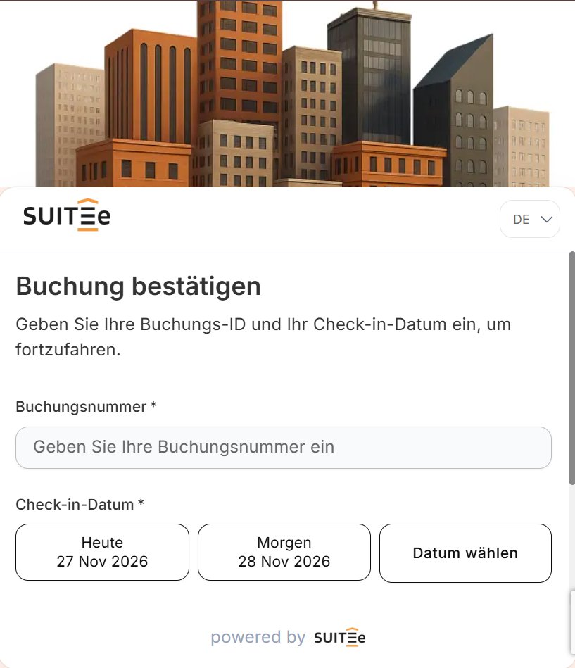
</Frame>

From this screen, a guest verifies their reservation before entering their stay view:

<Steps>
  <Step title="Select a language">
    Use the language selector in the top-right corner (for example, **DE**) to switch the interface language.
  </Step>
  <Step title="Enter the booking number">
    Enter the reservation ID in the **Buchungsnummer \*** (Booking number) field.
  </Step>
  <Step title="Choose the check-in date">
    Select the **Check-in-Datum \*** (Check-in date) using the quick date options or click **Datum wählen** to pick a date.
  </Step>
  <Step title="Accept terms and confirm">
    Check the box to agree to the Terms & Conditions and Privacy Policy, then click **Buchung bestätigen** to continue.
  </Step>
</Steps>

<Note>
  **Important:** The registration form does not open for everyone automatically. Without completing this registration, guest details will not be saved. If the registration page does not appear, contact [SUITEe support](https://suite-e.com/contact-us/) to enable access to the registration form.
</Note>

Once access to the registration form is enabled, follow the steps below to verify your booking, create your passcode, complete registration, and log in.

---

## Verifying your Booking ID and Check-in Date

To verify a reservation in the Guest Web App, the guest needs their **Booking ID** (their **PMS Booking ID** or **External Booking ID**) and their **check-in date**. Share these details with the guest, or look them up on the [Booking](/en/dashboard/booking) page.

<Note>
  **What is a PMS Booking ID vs. an External Booking ID?**
  - **PMS Booking ID (`Buchungs-ID`)**: The primary reservation identifier synced from your Property Management System—or generated by SUITEe for No-PMS properties (for example, `NP-9B4ADC-1`).
  - **External Booking ID (`Externe Buchungs-ID`)**: The reservation reference from an external booking channel or OTA (such as Booking.com or Expedia), visible in the **Externe Buchungs-ID** column on the [Booking](/en/dashboard/booking) page (direct bookings show `—`).

  Depending on how the reservation was made, enter the **PMS Booking ID** or **External Booking ID** provided to the guest (for example, `NP-9B4ADC-1`).
</Note>

To verify the booking in the Guest Web App:

<Steps>
  <Step title="Enter the Booking ID">
    Enter your **PMS Booking ID** or **External Booking ID** (for example, `NP-9B4ADC-1`) into the **Buchungsnummer \*** field.
  </Step>

  <Step title="Select the check-in date">
    Choose the matching **check-in date** under **Check-in-Datum \*** using **Heute**, **Morgen**, or **Datum wählen**.
  </Step>

  <Step title="Accept terms and verify">
    Check the checkbox to agree to the Terms & Conditions and Privacy Policy, then click **Buchung bestätigen** to verify the booking and continue.
  </Step>
</Steps>

---

## Creating your 4-digit passcode

After you click **Buchung bestätigen**, the **Erstellen Sie Ihren 4-stelligen Login-Code** screen opens so you can set up your login passcode and recovery email.

<Frame>
  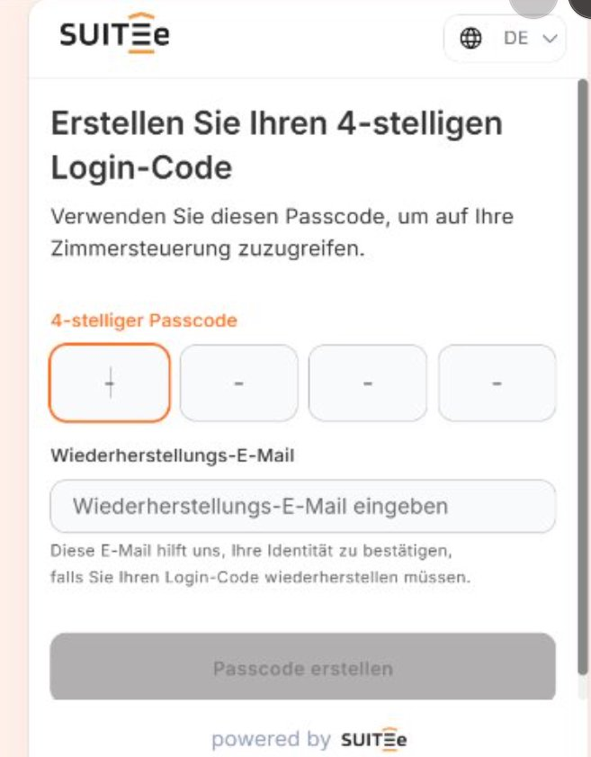
</Frame>

<Steps>
  <Step title="Enter a 4-digit passcode">
    Type a 4-digit code into the **4-stelliger Passcode** boxes. You will use this passcode to access your room controls and stay details.
  </Step>

  <Step title="Add your recovery email">
    Enter your email address in **Wiederherstellungs-E-Mail**. SUITEe uses this email to verify your identity if you ever need to reset your login code.
  </Step>

  <Step title="Create the passcode">
    Click **Passcode erstellen** to save your passcode and continue.
  </Step>
</Steps>

---

## Completing the guest registration form

<Note>
  **Important:** If your property uses SUITEe's guest registration feature, completing this registration form is **mandatory**. If guest registration is not enabled for your property, this form does not appear—instead, you log in directly with your **Booking ID** and **4-digit passcode**, and the registration form is not required.
</Note>

If guest registration is enabled, complete the two-part registration form carefully after creating your passcode.

### Step 1: Personal details (`Legen wir los`)

On the **Legen wir los** screen, review your pre-filled **Anreisedatum \*** (arrival date) and **Abreisedatum \*** (departure date), then enter your personal information.

<Frame>
  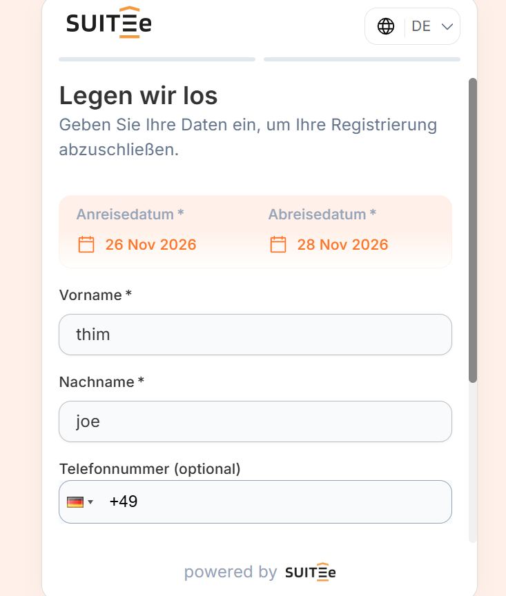
</Frame>

<Frame>
  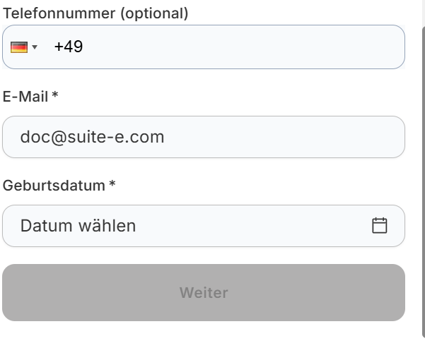
</Frame>

Fill in the fields below and click **Weiter** to move to the next step:

- **Vorname \*** — First name (mandatory)
- **Nachname \*** — Last name (mandatory)
- **Telefonnummer (optional)** — Phone number with country code
- **E-Mail \*** — Email address (mandatory)
- **Geburtsdatum \*** — Date of birth via **Datum wählen** (mandatory)

<Warning>
  **Required field validation:** All mandatory fields marked with `*` must be filled in accurately before **Weiter** is enabled. Both **Vorname \*** and **Nachname \*** must be at least **3 characters** long—shorter entries trigger validation errors (*Name muss mindestens 3 Zeichen lang sein* and *Nachname muss mindestens 3 Zeichen lang sein*).

  <Frame>
    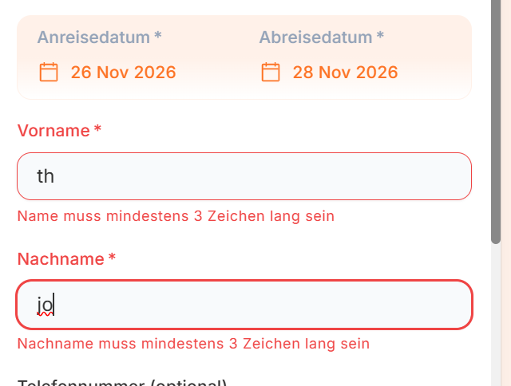
  </Frame>
</Warning>

### Step 2: Identification, address, signature, and additional guests

After clicking **Weiter**, the **Nur noch ein paar Details!** screen opens. Fill in all required identification and address details, add your signature, and include any accompanying guests.

<Frame>
  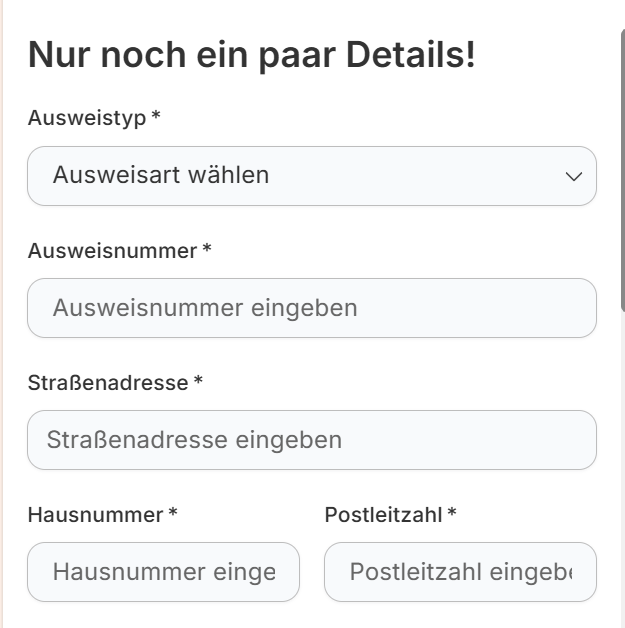
</Frame>

<Frame>
  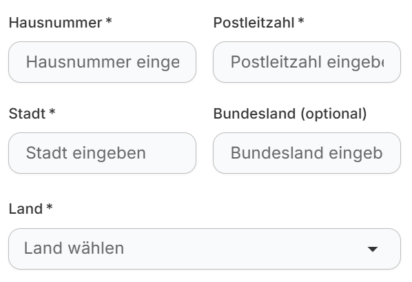
</Frame>

<Frame>
  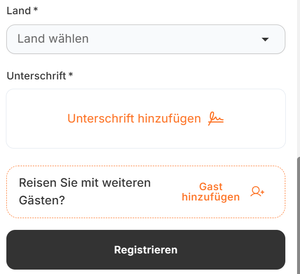
</Frame>

1. Select your **Ausweistyp \*** (ID type) from **Ausweisart wählen** and enter your **Ausweisnummer \*** (ID number).
2. Enter your **Straßenadresse \*** (street address), **Hausnummer \*** (house number), **Postleitzahl \*** (postal code), **Stadt \*** (city), optional **Bundesland**, and select your **Land \*** (country) from **Land wählen**.
3. Under **Unterschrift \***, click **Unterschrift hinzufügen** and provide a clear signature.
4. *(Optional)* If you are travelling with additional guests, click **Gast hinzufügen** under **Reisen Sie mit weiteren Gästen?** to open **Gast 1 Info** and fill in each guest's **Vorname \***, **Nachname \***, **Geburtsdatum \*** (**Datum wählen**), and **Nationalität \*** (**Land wählen**).

   <Frame>
     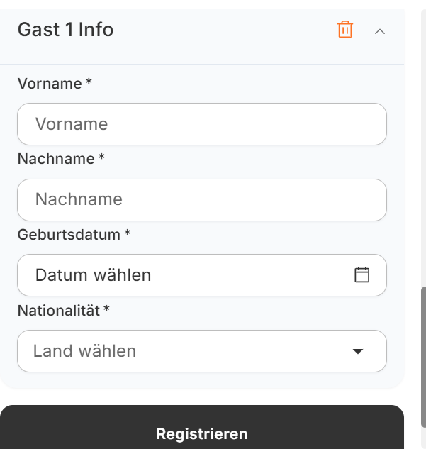
   </Frame>

5. Click **Registrieren** to complete your registration.

---

## Logging in with your 4-digit passcode

After clicking **Registrieren**, the Guest Web App displays the login screen (**Melden Sie sich in Ihrer SUITEe an**). Enter the **4-digit passcode** you created previously to sign in.

<Frame>
  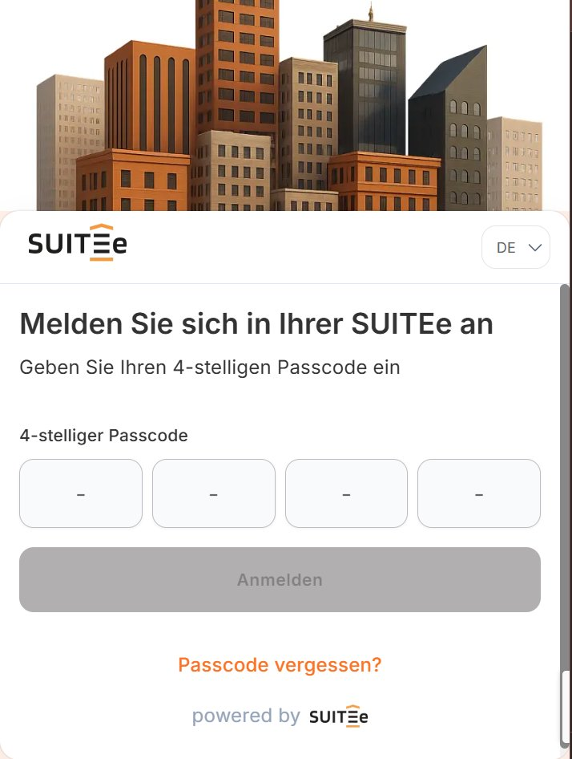
</Frame>

<Steps>
  <Step title="Enter your 4-digit passcode">
    On the **Melden Sie sich in Ihrer SUITEe an** screen, enter the 4-digit passcode you set earlier into the **4-stelliger Passcode** boxes.
  </Step>

  <Step title="Click Log in">
    Click **Anmelden** (Log in) to open your stay dashboard in the Guest Web App.

    <Tip>
      If you ever forget your passcode, click **Passcode vergessen?** below the **Anmelden** button to reset it using your recovery email.
    </Tip>
  </Step>
</Steps>

---

## Next steps

<Card title="Guest Web App" icon="mobile-screen" href="/en/guest-web-app/guest-web-app">
  Explore your stay details after logging in — welcome page, early check-in requests, Wi-Fi, emergency contact, and property chat.
</Card>

